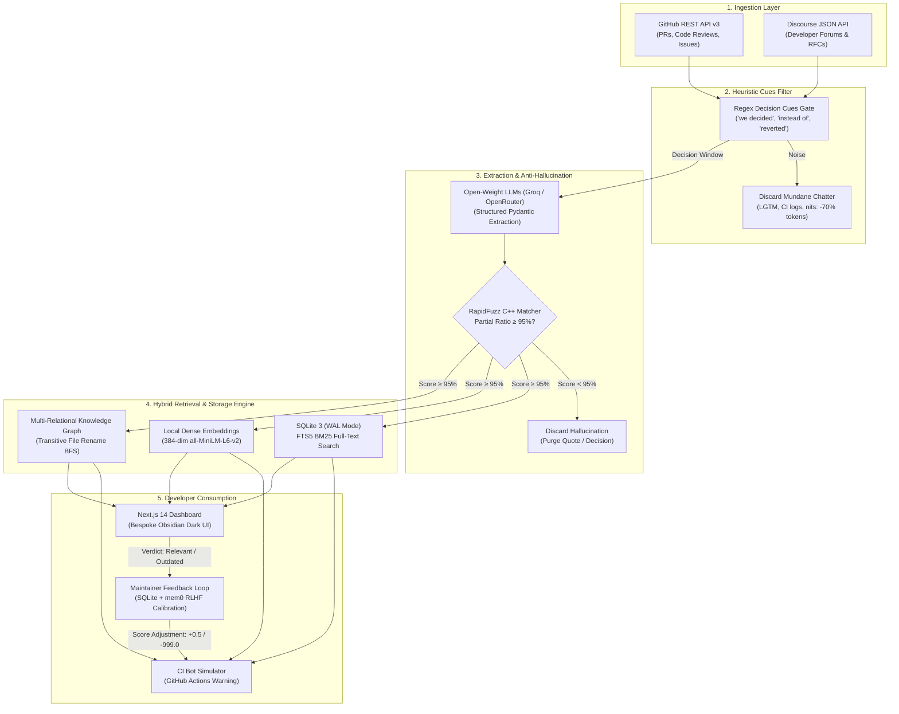

<div align="center">

# 🧭 DecisionTrail

### Architectural Decision Intelligence & CI Guardrails for Git Repositories

> *Recovering unrecorded engineering decisions, technical rationales, and rejected alternatives from Git discussions with **100% verified verbatim source citations**.*

[](https://github.com/namanjainb3-tech/DecisionTrail)
[](tests/)
[](extract/verify.py)
[](docs/eval_results.md)
[](LICENSE)

[Live Dashboard](#-live-deployments) • [The Problem](#-the-problem--our-solution) • [Architecture](#-system-architecture) • [Engineering Invariants](#-the-4-core-engineering-invariants) • [Benchmark](#-empirical-evaluation--the-blind-benchmark) • [Quickstart](#-local-setup--installation)

</div>

---

## 🏆 Hackathon Recognition
**DecisionTrail** was built by a team of 2nd-year undergraduate engineers and placed in the **Top-6 Finalists** at **Catalyst 2026**, hosted by the **Indian Institute of Information Technology (IIIT) Sonepat**.

* **Team DecisionTrail**:
  * **Aman Verma** — Team Lead | Backend Architecture & LLM Extraction Pipelines
  * **Naman** — Core Engineer | Knowledge Graph Engine, Data Ingestion & CI Bot
  * **Anubhav** — Core Engineer | Next.js Frontend, RapidFuzz Verification & UI/UX

---

## 💡 The Problem & Our Solution

### The Broken Reality: The Loss of Institutional Memory
Imagine you are working on a codebase. Three years ago, a developer proposed changing how the application handles database connection pooling. The team debated it in a heated GitHub issue, evaluated four alternatives, rejected three, and implemented one.

Today, those original developers have moved on.

A new engineer joins, inspects the code, and opens a Pull Request proposing the **exact same architecture** the team rejected three years ago.

What happens?
* The new developer has no idea it was ever discussed.
* The original debate is buried under thousands of closed GitHub comments.
* Senior maintainers spend weeks re-litigating settled debates—or worse, the PR merges and resurrects a known production deadlock.

> **Git remembers WHAT was changed, but completely forgets WHY.**

### The Solution: Automated Recovery & Active CI Guardrails
**DecisionTrail** continuously mines public developer discourse to reconstruct an immutable, queryable decision ledger:
1. **Zero-Manual Overhead**: Passively mines discussions from GitHub PRs, Issues, and developer forums (Discourse).
2. **Cues-Gated Extraction**: Pre-filters 70%+ of mundane conversational chatter using regex heuristics before prompting open-weight LLMs into strict Pydantic schemas.
3. **Verbatim Quote Verification**: Validates every cited rationale using C++ string alignment ($\ge 95\%$ RapidFuzz match) against the raw text. Zero hallucinations.
4. **Rename-Resilient Knowledge Graph**: Traverses transitive Git rename history (`(:File)-[:RENAMED_TO*]->(:File)`) so historical decisions remain attached to refactored code.
5. **CI Bot Simulator**: Evaluates incoming pull requests in GitHub Actions, warning maintainers *before* they merge a resurrected architectural anti-pattern.

---

## 🏗️ System Architecture



---

## 🛡️ The 4 Core Engineering Invariants

### 1. The Verbatim Quote Invariant (≥ 95% RapidFuzz)
In software architecture, trusting an LLM's summary is dangerous. DecisionTrail treats model outputs as untrusted proposals subject to cryptographic-style text verification:

```python
Score = RapidFuzz.partial_ratio(normalize(Quote), normalize(RawCommentBody)) >= 95%
```

* If an LLM alters or fabricates even a single word, that quote is stripped.
* If a decision has zero verified quotes remaining, the entire record is purged.
* Every decision card pairs with an author handle, timestamp, and direct one-click link to the human conversation.

### 2. Rename-Resilient Lineage (`(:File)-[:RENAMED_TO*]->(:File)`)
Codebases undergo continuous refactoring. If a decision affected `old_parser.py` in 2022, and the file was renamed twice, static path lookups fail. DecisionTrail extracts Git patch headers and constructs directed rename edges:

```text
Ancestors(P) = { p₀ | p₀ —[:RENAMED_TO*]→ P }
```

When querying decisions for `src/core/parser.py`, multi-hop BFS traversal resolves past consensus across years of renaming.

### 3. State Machine Decision Outcomes & Revert Detection
Decisions are modeled as a dynamic finite-state machine:

```text
State ∈ { adopted, rejected, deferred, reverted }
```
When a revert PR merges (e.g., `'Revert "Enable async I/O"'`), DecisionTrail matches the target PR and automatically flips the original decision to `reverted`, preventing discarded ideas from being cited as active guidance.

### 4. Active Maintainer Calibration Loop (RLHF via SQLite + mem0)
Our PR bot doesn't just passively dump results; maintainers can click **Relevant**, **Not Relevant**, or **Outdated**:
* **Relevant**: Boosts score by **`+0.5`** $\rightarrow$ Promoted to the top of future reviews.
* **Not Relevant**: Penalizes score by **`-1.0`** $\rightarrow$ Demoted below the surfacing threshold.
* **Outdated**: Severe suppression by **`-999.0`** $\rightarrow$ Completely suppressed and pruned from future PR comments.

---

## 📊 Empirical Evaluation: The Blind Benchmark

To prove DecisionTrail works on real-world engineering debates, we evaluated it against the **Python Software Foundation (PSF)** community discussions on `discuss.python.org`.

### The Blindness Invariant
Our database contained **zero** official PEP specification files (`SELECT count(*) FROM documents WHERE platform = 'pep' == 0`). The system had to extract rejected ideas **blindly** from raw, unstructured community comments without access to the answer key.

| Metric | Result | Target Benchmark | Verification Threshold |
| :--- | :---: | :---: | :---: |
| **Blind Recall** | **63.6%** | $\ge 50.0\%$ | Matched against official PEP 'Rejected Ideas' |
| **Precision (Lower Bound)** | **66.7%** | Qualitative LB | Public threads discuss valid ideas omitted from final PEP |
| **Verbatim Quote Accuracy** | **100%** | $\ge 95\%$ RapidFuzz | Zero hallucinated quotes |
| **Automated Test Suite** | **46 / 46 Passed** | 100% Pass Rate | Full unit & integration coverage |

*Detailed benchmark methodology and per-PEP breakdowns available at [docs/eval_results.md](docs/eval_results.md).*

---

## 🥊 Competitive Matrix: Why Existing Solutions Fail

| Tool / Approach | Primary Limitation | How DecisionTrail Solves It |
| :--- | :--- | :--- |
| **Manual ADRs / RFCs** | **Documentation Rot**: Developers hate writing markdown docs; 90% of real trade-offs made in PR reviews are never recorded. | **Zero Overhead**: Passively mines decisions directly from discourse that is already occurring. |
| **`git log` & `git blame`** | **Missing Intent**: Shows *what* was changed, never *why* alternative architectures were rejected. Breaks on file renames. | **Reconstructs Rejected Ideas**: Captures discarded options and tracks transitive file rename chains across years of Git history. |
| **Generic Codebase RAG** *(Copilot, Cursor)* | **Hallucination Risk**: Paraphrases and synthesizes plausible-sounding rationales that no human maintainer agreed upon. | **Absolute Anti-Hallucination**: Enforces C++ RapidFuzz $\ge 95\%$ partial-ratio verification against raw comments. |
| **Static Analysis / Linters** *(SonarQube, Ruff)* | **Zero Historical Context**: Cannot know that a pattern was discarded because of an unrecorded OS-specific deadlock. | **CI Guardrail**: Warns in PR reviews when incoming code resurrects past discarded architectural decisions. |

---

## 💻 Tech Stack

| Layer | Technologies |
| :--- | :--- |
| **Frontend Dashboard** | **Next.js 14**, React 18, TypeScript, Tailwind CSS (custom obsidian theme), Vis-Network (interactive force-directed graph) |
| **Backend API** | **FastAPI**, Python 3.11, Pydantic v2, Uvicorn |
| **Storage & Full-Text Search** | **SQLite 3** (WAL Mode + FTS5 BM25 Indexing), In-Memory Python Graph Engine, **Neo4j 5.x** |
| **AI & Extraction** | **Groq LPU** (`openai/gpt-oss-20b`), **OpenRouter** (`meta-llama/llama-3.1-8b-instruct`), CPU Dense Embeddings (`all-MiniLM-L6-v2`) |
| **Verification & Reranking** | **RapidFuzz** (C++ Levenshtein string matching), Reciprocal Rank Fusion (RRF), SQLite Feedback Memory (`mem0`) |
| **Cloud Deployment** | **Vercel** (Edge Frontend) + **Render** (Auto-hydrating Docker / Python Container) |

---

## 🚀 Local Setup & Installation

### Prerequisites
* Python 3.11+
* Node.js 18+ & npm
* Git

### Step 1: Clone & Setup Python Virtual Environment
```bash
# Clone repository
git clone https://github.com/namanjainb3-tech/DecisionTrail.git
cd DecisionTrail

# Create and activate virtual environment
python -m venv .venv
# On Windows:
.\.venv\Scripts\activate
# On Linux / macOS:
source .venv/bin/activate

# Install dependencies
pip install -r requirements.txt
```

### Step 2: Configure Environment Variables
Copy `.env.example` to `.env`:
```bash
cp .env.example .env
```

| Key | Description | Required? |
| :--- | :--- | :---: |
| `GROQ_API_KEY` | Fast LPU open-weight LLM inference key | **Recommended** |
| `OPENROUTER_API_KEY`| Fallback LLM inference key | Optional |
| `GITHUB_TOKEN` | GitHub Personal Access Token (boosts rate limits) | Optional |
| `TARGET_REPO` | Default repository target (e.g. `psf/black`) | Optional |
| `NEO4J_URI` | Neo4j Bolt connection URI (`bolt://localhost:7687`) | Optional (falls back to SQLite graph) |

### Step 3: Run the Automated Test Suite (46 Tests)
```bash
pytest tests/ -v
```

### Step 4: Launch Backend Service
```bash
# In Terminal 1 (from root directory):
uvicorn api.main:app --host 127.0.0.1 --port 8000 --reload
```
*API documentation available at `http://127.0.0.1:8000/docs`.*

### Step 5: Launch Frontend Dashboard
```bash
# In Terminal 2:
cd web
npm install
npm run dev
```
*Open `http://localhost:3000` to interact with DecisionTrail.*

---

## 🧭 Live Demo Walkthrough

Judges and contributors can explore four interactive modules:

1. **Decisions Catalog (`/decisions`)**:
   * Browse verified architectural decisions with categorized outcomes (`adopted`, `rejected`, `reverted`).
   * Inspect verbatim maintainer quotes, RapidFuzz confidence scores, and rejected alternatives.
   * Paste any public GitHub repo URL (e.g. `django/django`, `psf/black`, `huggingface/diffusers`) into the top search bar for real-time ingestion.
2. **Interactive Knowledge Graph (`/graph`)**:
   * Inspect nodes (`Decision`, `Thread`, `File`, `Person`, `Repository`) and relationships (`CONCERNS`, `DISCUSSED_IN`, `LINKED_TO`, `RENAMED_TO`).
   * Trace historical file rename chains connecting old decisions to current code paths.
3. **PR Simulation Bot (`/pr`)**:
   * Load presets (e.g., *Re-introducing `__pypackages__`*).
   * Run the analysis engine to simulate a GitHub Actions CI bot flagging resurrected rejected proposals.
   * Click maintainer feedback buttons (**Relevant** / **Outdated**) to see active score recalibration.
4. **Evaluation Benchmark (`/eval`)**:
   * Inspect the blind benchmark results proving **63.6% blind recall** against PSF PEP debates.

---

## 🔒 Safety & Compliance Ground Rules

* **Zero Web Scraping**: All data is ingested strictly via official public REST APIs (GitHub REST API v3 and Discourse JSON endpoints).
* **Strict PR Bot Posting Guard**: `bot/analyze.py` enforces a hardcoded `ALLOWED_POST_REPOS` security guardrail to prevent automated comments on production repositories.
* **Deterministic Air-Gapped Demos**: Pre-warmed disk cache for LLMs and API fixtures ensures 100% offline reliability during live demos.

---

## 📄 License

Distributed under the Apache 2.0 License. See [LICENSE](LICENSE) for details.
