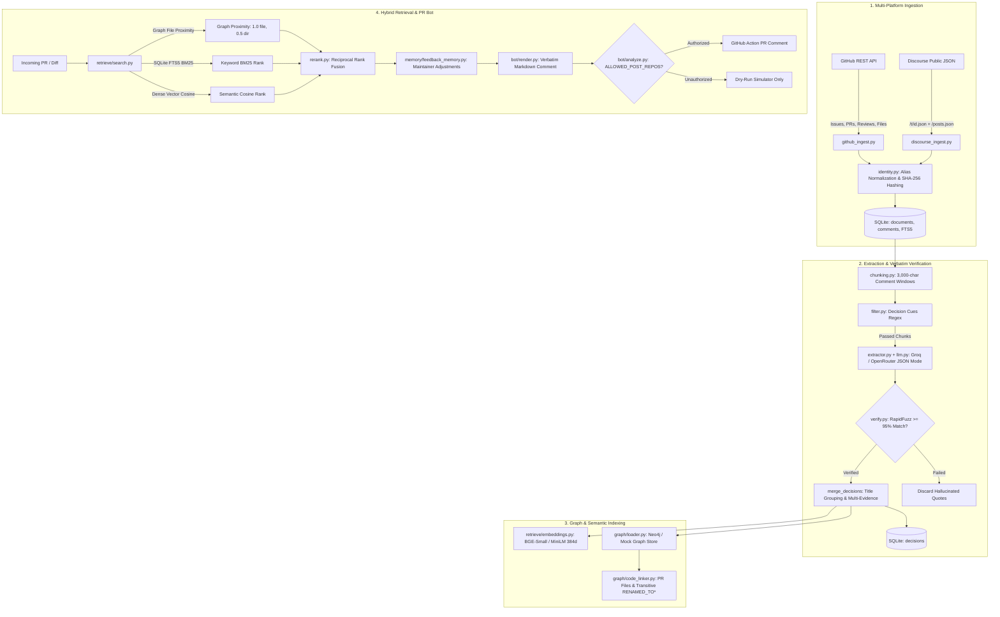

# DecisionTrail — System Architecture & Technical Specification

DecisionTrail is an autonomous decision intelligence engine that mines unrecorded architectural and design decisions from public discussion threads (GitHub Issues, Pull Requests, Reviews, and Discourse/Forums). Every extracted decision and rejected alternative is backed by machine-verified verbatim citations.

---

## 1. High-Level System Architecture

---

## 2. Core Data Contracts (`core/models.py`)

All data exchanges adhere to frozen, strongly validated Pydantic v2 schemas:

### `Evidence`
Represents an immutable, machine-verified source citation:
* `source_url`: Absolute URL to the issue comment, review comment, or forum post.
* `platform`: Categorical source type (`"github_issue" | "github_pr" | "github_review" | "discourse"`).
* `author_handle`: Normalized username of the contributor.
* `posted_at`: Exact ISO datetime timestamp.
* `quote`: Exact verbatim string excerpt from the source text.

### `RejectedAlternative`
Represents an architectural path that was considered and explicitly discarded:
* `text`: Summary of the proposed alternative.
* `reason`: Explicit justification for why it was abandoned.
* `evidence`: Mandatory `Evidence` object with verbatim quote.

### `Decision`
Represents a synthesized engineering decision:
* `id`: Stable SHA-1 hash of `(thread_id + title)`.
* `repo_or_forum`: Target repository or community namespace.
* `thread_id`: Unique thread identifier.
* `title`: Concise descriptive summary.
* `outcome`: Categorical status (`"adopted" | "rejected" | "reverted" | "deferred"`).
* `rationale`: Comprehensive explanation of the chosen approach.
* `alternatives`: List of `RejectedAlternative` instances.
* `evidence`: List of verified `Evidence` items (minimum length $\ge 1$).
* `confidence`: Extractor score bounded strictly between $0.0$ and $1.0$.
* `decided_at`: ISO datetime when the consensus was reached.
* `linked_paths`: Relative repository file paths affected by this decision.
* `extractor_model`: Identifier of the LLM that produced the extraction.

---

## 3. Storage Layer: Dual-Engine Design

### SQLite System of Record (`core/db_sqlite.py`)
* **`documents`**: Full raw discussion metadata and serialized thread payloads.
* **`comments`**: Individual comments indexed by `comment_id`, `author_handle`, `posted_at`, and `thread_id`.
* **`comments_fts`**: SQLite FTS5 full-text virtual table tokenized via Porter stemming and unicode61 tokenizer.
* **`aliases`**: Identity mapping table connecting multi-platform handles via SHA-256 email digests and display names.
* **`ingest_cursors`**: Tracks source incremental timestamps (`last_updated_at`) preventing duplicate ingestion.
* **`decisions`**: Persisted decisions with JSON-serialized alternatives, evidence, and affected file paths.
* **`eval_results`**: Audit table logging ground-truth counts, recovered counts, recall, precision, and LLM judge rationale.

### Neo4j Knowledge Graph & Offline Mock (`graph/loader.py`)
When Neo4j is available, nodes and edges are persisted using Cypher `MERGE`. When operating offline or without Docker, an in-memory graph store provides identical traversal and vector scoring semantics:
* **Node Labels**:
  * `(:Decision {id, title, outcome, rationale, confidence, decided_at, embedding})`
  * `(:File {id, path})`
  * `(:Person {id, name, handle})`
  * `(:Source {id, url, platform})`
* **Relationship Types**:
  * `(:Decision)-[:AFFECTS]->(:File)`
  * `(:Decision)-[:AUTHORED_BY]->(:Person)`
  * `(:Decision)-[:SOURCED_FROM]->(:Source)`
  * `(:File)-[:RENAMED_TO]->(:File)`

---

## 4. Verbatim Quote Verification Engine (`extract/verify.py`)

To eliminate hallucination inherent in open-weight language models, DecisionTrail enforces a zero-tolerance verification policy:

$$\text{MatchScore}(Q, C) = \text{RapidFuzz.partial\_ratio}(\text{normalize}(Q), \text{normalize}(C))$$

1. Normalization collapses consecutive whitespace, normalizes unicode punctuation, and strips outer markdown quote tokens.
2. The partial ratio matches substring alignments with an empirical threshold of $\ge 95\%$.
3. If an alternative's quote falls below $95\%$, the alternative is deleted.
4. If a decision has zero verified quotes remaining in its evidence set, the entire decision is discarded.

---

## 5. Hybrid Retrieval & RRF Math (`retrieve/search.py`, `retrieve/rerank.py`)

When evaluating a Pull Request with changed paths $P$, title $T$, and diff $D$:

1. **Graph Proximity Score ($S_{\text{graph}}$)**:
   * Direct file match ($p \in P$ linked via `AFFECTS` or `RENAMED_TO*`): $1.0$.
   * Directory sibling match ($\text{parent}(p) == \text{parent}(f)$): $0.5$.
2. **BM25 Lexical Score ($S_{\text{bm25}}$)**:
   * Computed via SQLite FTS5 over indexed comment bodies using $T$ and key diff tokens.
3. **Dense Semantic Cosine Score ($S_{\text{vector}}$)**:
   * Computed via local 384-dimensional embeddings (`BAAI/bge-small-en-v1.5` or `all-MiniLM-L6-v2`) measuring cosine distance between PR context and Decision embeddings.
4. **Reciprocal Rank Fusion (RRF)**:

$$RRF(d) = \sum_{m \in M} \frac{w_m}{60 + \text{rank}_m(d)}$$

where weights are $w_{\text{graph}} = 1.0$, $w_{\text{vector}} = 0.8$, $w_{\text{bm25}} = 0.5$.

5. **Maintainer Memory Delta ($\Delta_{\text{mem}}$)**:
   * `relevant`: $+0.5$
   * `not_relevant`: $-1.0$ (or below threshold)
   * `outdated`: Suppressed entirely with warning annotation.

Only decisions scoring above threshold $\tau = 0.35$ are formatted into the GitHub PR comment, capped at a maximum of 3 decisions to eliminate developer noise.
