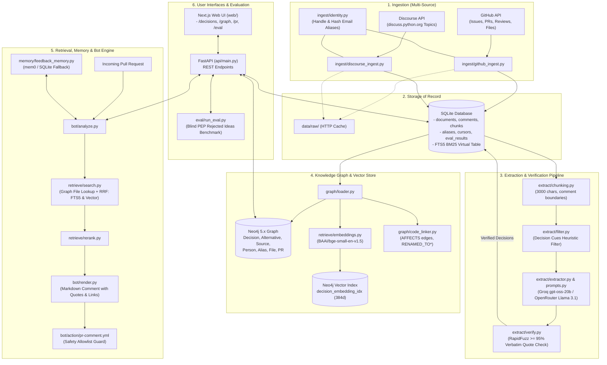
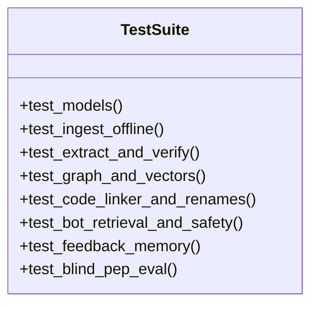

# DecisionTrail: Comprehensive Project Execution Plan

> **Executive Summary & North Star:**
> DecisionTrail solves the perpetual software engineering dilemma: *"Why was it done this way?"* By reading public discussions (GitHub issues, PR reviews, and Discourse threads), it extracts structured technical decisions (what was decided, alternatives considered, why they were rejected), grounds them in the codebase through a Neo4j knowledge graph with rename resilience, and proactively surfaces them via an automated PR bot and web dashboard when developers touch relevant code.
> 
> **Core Non-Negotiable Principle:** **100% Verifiable Source Traceability.** Every decision and rejected alternative must carry a verbatim quote, author, timestamp, and source URL. Any candidate extraction failing strict quote verification against raw source text is dropped. Zero hallucinated consensus is tolerated.

---

## 1. System Architecture & Component Design

### 1.1 High-Level Architecture Flow

### 1.2 Storage Strategy
- **SQLite (`core/db_sqlite.py`)**: Authoritative System of Record. Stores raw documents, comments, comment chunks, alias mappings, ingestion cursors, verified extracted decisions, and evaluation runs. Features an **FTS5** virtual table indexing comment bodies for fast BM25 keyword retrieval.
- **Neo4j 5.x (`core/db_neo4j.py` & `graph/loader.py`)**: Graph relational engine and Vector Store. Represents topological connections between decisions, rejected alternatives, people, aliases, historical files, and PRs. Hosts a 384-dimensional cosine vector index (`decision_embedding_idx`) on `Decision.embedding`. Can be completely dropped and rebuilt deterministically from SQLite at any time via `rebuild_from_sqlite()`.

### 1.3 Data Contracts (Strict Pydantic v2 Models)
Implemented in `core/models.py` and treated as frozen:
- `Evidence`: `source_url`, `platform` (`github_issue` | `github_pr` | `github_review` | `discourse`), `author_handle`, `posted_at`, `quote` (verified verbatim).
- `RejectedAlternative`: `text` (proposed concept), `reason` (rationale for rejection), `evidence` (`Evidence`).
- `Decision`: `id` (SHA1 of `thread_id + title`), `repo_or_forum`, `thread_id`, `title`, `outcome` (`adopted` | `rejected` | `reverted` | `deferred`), `rationale`, `alternatives` (`list[RejectedAlternative]`), `evidence` (`list[Evidence]`, minimum 1 required), `confidence` (0.0 to 1.0), `decided_at`, `linked_paths`, `extractor_model`.
- `Document`: `thread_id`, `platform`, `url`, `title`, `created_at`, `comments` (`list[Comment]`).
- `Comment`: `comment_id`, `author_handle`, `author_email` (or hash), `posted_at`, `body`, `url`.

---

## 2. Phased Build Plan & Execution Sequence

```mermaid
gantt
    title DecisionTrail Implementation Phases
    dateFormat  X
    axisFormat  Day %d
    section Phase 0 & 1
    Phase 0 Scaffold & Contracts     :active, p0, 0, 1
    Phase 1 Ingestion Pipeline       :p1, 1, 3
    section Phase 2 & 3
    Phase 2 Extraction & Verification :p2, 2, 5
    Phase 3 Graph Loading & Vectors  :p3, 3, 5
    section Phase 4, 5 & 6
    Phase 4 Code Linking & Renames   :p4, 5, 6
    Phase 5 Retrieval & PR Bot       :p5, 6, 8
    Phase 6 Feedback Memory (mem0)   :p6, 7, 8
    section Phase 7, 8 & 9
    Phase 7 Blind PEP Evaluation     :p7, 5, 8
    Phase 8 Web Frontend (Next.js)   :p8, 3, 9
    Phase 9 Hardening & Offline Demo :p9, 8, 10
```

---

### Phase 0: Scaffold, Environment, & Core Contracts
* **Goal**: Establish the repository skeleton, freeze shared data contracts, initialize SQLite & Neo4j clients, implement the cached LLM wrapper, and verify basic services.
* **Files to Create/Edit**:
  - `core/__init__.py`
  - `core/models.py` (Exact frozen Pydantic models from Section 6)
  - `core/config.py` (Pydantic Settings: tokens, DB URIs, models, thresholds)
  - `core/db_sqlite.py` (Tables: `documents`, `comments`, `chunks`, `aliases`, `ingest_cursors`, `decisions`, `eval_results`, plus FTS5 virtual table)
  - `core/db_neo4j.py` (Neo4j driver, constraints creation, vector index creation)
  - `core/llm.py` (`complete_json(prompt, schema)` with retry, JSON repair, fallback model, and disk caching in `data/raw/llm_cache/`)
  - `docker-compose.yml` (Neo4j 5.x container configuration with volume persistence)
  - `api/main.py` (FastAPI app skeleton with `GET /health`)
  - `.env.example`, `.gitignore`, `README.md` stub
  - `tests/test_models.py`, `tests/test_core.py`
* **Implementation Details**:
  - `complete_json` caches raw model outputs keyed by `sha256(prompt + schema)`. If cache exists, returns cached response instantly (guaranteeing reproducible, offline-friendly execution).
  - Pydantic models enforce non-empty evidence validation (`@field_validator('evidence')`).
* **Acceptance Checks**:
  1. `docker compose up -d` starts Neo4j and passes healthcheck.
  2. `pytest tests/test_models.py` passes (confirms models validate valid entities and reject decisions lacking evidence).
  3. `uvicorn api.main:app` responds `{"status": "ok"}` on `GET /health`.
  4. `complete_json()` runs a prompt, writes to cache, and serves subsequent identical calls from disk cache without making network calls.

---

### Phase 1: Multi-Source Ingestion Pipeline
* **Goal**: Ingest GitHub issues, PRs, and review comments, alongside Discourse topics, into SQLite as canonical `Document` objects with incremental cursor management.
* **Files to Create/Edit**:
  - `ingest/__init__.py`
  - `ingest/github_ingest.py` (REST client for repo issues, PRs, comments, review comments, changed files)
  - `ingest/discourse_ingest.py` (Discourse topic & post stream scraper, HTML to markdown/text converter, 1-sec polite sleep)
  - `ingest/identity.py` (Handle normalization, SHA-256 email hashing, alias resolution)
  - `tests/test_ingest.py`
  - `tests/fixtures/github/` & `tests/fixtures/discourse/` (Offline mock JSON fixtures)
* **Implementation Details**:
  - **GitHub Connector**: Queries target repo (default `psf/black`). Ingests closed issues & merged/closed PRs. Collects filenames and `previous_filename` for rename tracking. Ignores bot authors (e.g. `[bot]`, `dependabot`, `pre-commit-ci`).
  - **Discourse Connector**: Resolves topic URL, parses `post_stream.stream`, batches post fetching (`/t/{id}/posts.json?post_ids[]=...`), cleans HTML to clean plaintext.
  - **Incremental Cursors**: Reads and updates `ingest_cursors` table (`source_type`, `source_id`, `last_updated_at`). Upserts comments by `comment_id`.
  - **Identity Resolution**: Canonical person ID assigned by matching normalized handle or `sha256(email)`. Never stores cleartext emails.
  - **Disk Caching**: Every raw API response written to `data/raw/`.
* **Acceptance Checks**:
  1. Running ingestion against 20 sample GitHub threads and 3 Discourse topics populates SQLite `documents` and `comments`.
  2. Idempotency test: Re-running ingestion inserts zero duplicates and honors cursors.
  3. `pytest tests/test_ingest.py` passes completely offline using saved fixtures, verifying HTML sanitization and cursor logic.

---

### Phase 2: Decision Extraction & Verbatim Verification Pipeline
* **Goal**: Transform conversation threads into verified `Decision` records with strictly verified verbatim quotes and rejected alternatives.
* **Files to Create/Edit**:
  - `extract/__init__.py`
  - `extract/chunking.py` (Sliding comment windows <= 3000 chars, preserving boundary and metadata)
  - `extract/filter.py` (Decision cue regex/keyword heuristic filtering)
  - `extract/prompts.py` (Structured JSON extraction prompts enforcing quotes & reasons)
  - `extract/extractor.py` (LLM orchestrator with batching and fallback)
  - `extract/verify.py` (RapidFuzz normalized string alignment with >= 95 score threshold)
  - `tests/test_extract.py`
  - `docs/extraction_notes.md` (Manual spot-check audit log)
* **Implementation Details**:
  - **Chunking**: Merges contiguous comments while preserving individual `comment_id` and `author_handle`. Prepends thread title to maintain context.
  - **Heuristic Filter**: Screens chunks for keywords ("decided", "instead of", "rejected", "won't", "reverted", "alternative", "downside", "closing because", etc.). Records filter hit-rate.
  - **Extraction**: Calls `complete_json` specifying `{title, outcome, rationale, alternatives: [{text, reason, quote, comment_id}], quote, comment_id, confidence}`.
  - **Quote Verification**: For every quote (in both decision evidence and alternative evidence), fetches the exact comment body from SQLite. Normalizes whitespace and runs `rapidfuzz.fuzz.partial_ratio(quote, body)`. If `< 95`, the alternative or decision is discarded. If a decision has zero valid evidence, it is dropped entirely.
  - **De-duplication / Merging**: Merges extractions with equivalent normalized titles from the same thread.
* **Acceptance Checks**:
  1. `pytest tests/test_extract.py` tests adversarial test cases (synthetic fabricated quotes are strictly rejected; valid quotes pass).
  2. Run extraction on 10 real cached threads, manual spot-check of 10 decisions documented in `docs/extraction_notes.md`.
  3. 100% of decisions stored in SQLite validate against `Decision` schema and carry verified evidence.

---

### Phase 3: Knowledge Graph Loading & Vector Indexing
* **Goal**: Ingest decisions, people, sources, and files into Neo4j with relationship topology and build a vector similarity index on decision embeddings.
* **Files to Create/Edit**:
  - `graph/__init__.py`
  - `graph/loader.py` (Cypher MERGE queries for idempotent loading, neighborhood queries)
  - `retrieve/__init__.py`
  - `retrieve/embeddings.py` (Local `sentence-transformers/all-MiniLM-L6-v2` or `BAAI/bge-small-en-v1.5`, 384 dimensions)
  - `tests/test_graph.py`
  - `tests/fixtures/sample_decisions.json`
* **Implementation Details**:
  - **Neo4j Schema**:
    - Nodes: `Decision`, `Alternative`, `Source`, `Person`, `Alias`, `File`, `PR`.
    - Edges: `(Decision)-[:HAS_ALTERNATIVE]->(Alternative)`, `(Decision)-[:SUPPORTED_BY]->(Source)`, `(Alternative)-[:SUPPORTED_BY]->(Source)`, `(Person)-[:AUTHORED]->(Source)`, `(Alias)-[:ALIAS_OF]->(Person)`.
  - **Vector Index**: Computes embedding on `f"{title}. {rationale}. " + " ".join([f"{a.text}: {a.reason}" for a in alternatives])`. Writes to `Decision.embedding` and indexes via `db_neo4j.py`.
  - **Rebuild Utility**: `rebuild_from_sqlite()` provides single-command graph re-hydration from the SQLite record.
* **Acceptance Checks**:
  1. Ingesting `sample_decisions.json` fixture twice yields identical node and edge counts.
  2. Cypher queries retrieve decision neighborhoods with intact source URLs and quotes.
  3. Vector similarity search returns top-ranked decision for a semantic paraphrase query.

---

### Phase 4: Code Linking & Rename History Tracking
* **Goal**: Map decisions to affected repository files, construct rename chains (`RENAMED_TO*`), and detect code reverts.
* **Files to Create/Edit**:
  - `graph/code_linker.py` (PR-to-file linking, issue-PR resolution, rename graph builder, revert detector)
  - `tests/test_code_linker.py`
* **Implementation Details**:
  - **Direct PR Linking**: Decisions extracted from PR threads automatically link `(Decision)-[:AFFECTS]->(File)` for all files modified in that PR.
  - **Issue Linking**: Scans issue comments and PR bodies for cross-references ("fixes #123", "closes #123", `#123`). Files modified in the resolving PR are linked to the issue's decisions.
  - **Rename Handling**: Extracts `(filename, previous_filename)` pairs from PR metadata. Creates `(f1:File {path: old})-[:RENAMED_TO]->(f2:File {path: new})`. Path resolution queries traverse `MATCH (f:File {path: $query_path})<-[:RENAMED_TO*0..]-(origin:File)<-[:AFFECTS]-(d:Decision) RETURN d`.
  - **Revert Detection**: Detects PR titles matching `^Revert ("|')?.*`. Identifies target decision and updates `outcome = "reverted"`.
* **Acceptance Checks**:
  1. Synthetic rename history test: File `src/old.py` renamed to `src/new.py`. A query touching `src/new.py` retrieves a decision originally made on `src/old.py`.
  2. Revert test: Ingesting a revert PR modifies decision outcome to `reverted`.
  3. Issue-to-PR linking correctly links files to decisions originating in issue discussions.

---

### Phase 5: Retrieval Engine & PR Bot
* **Goal**: Build candidate retrieval combining file graph proximity and hybrid search (BM25 + Vector RRF), generate verified PR bot summaries, and implement GitHub Action bot comment posting with safety allowlists.
* **Files to Create/Edit**:
  - `retrieve/search.py` (Graph path lookup + Reciprocal Rank Fusion of SQLite FTS5 BM25 and Neo4j vector cosine distance)
  - `retrieve/rerank.py` (Candidate filtering, file weight adjustment: 1.0 exact file, 0.5 directory match, threshold cutoff, top-3 cap)
  - `bot/__init__.py`
  - `bot/analyze.py` (PR diff analyzer, candidate orchestrator, LLM one-sentence relevance generator)
  - `bot/render.py` (Markdown bot comment formatter with verbatim quotes and discussion links)
  - `bot/action/pr-comment.yml` (GitHub Action workflow definition)
  - `tests/test_bot.py`
* **Implementation Details**:
  - **Hybrid Search & RRF**:
    $$\text{Score}(d) = \sum_{m \in \{\text{FTS5}, \text{Vector}\}} \frac{w_m}{60 + \text{rank}_m(d)} + w_{\text{graph}} \cdot \text{GraphScore}(d)$$
  - **Threshold Policy**: If maximum candidate score is below threshold, return 0 decisions. Silence is strictly preferred to noise.
  - **Safety Allowlist**: `ALLOWED_POST_REPOS` env var. If the repository name does not match the allowlist, bot execution raises `SecurityException` and refuses to post.
* **Acceptance Checks**:
  1. Unit test: Simulated PR touching `black/linegen.py` retrieves the known formatting decision; simulated PR touching unrelated file produces empty result.
  2. Formatted comment contains all mandatory components: title, outcome badge, verbatim quote, author, date, and link.
  3. Security check: Posting to unauthorized repository throws an immediate exception.

---

### Phase 6: Maintainer Feedback Memory (mem0 + Graceful SQLite Fallback)
* **Goal**: Enable the bot to remember maintainer feedback (`relevant`, `not_relevant`, `outdated`) and adjust future PR retrieval rankings.
* **Files to Create/Edit**:
  - `memory/__init__.py`
  - `memory/feedback_memory.py` (Interface `FeedbackMemory`, `Mem0FeedbackMemory`, `SQLiteFeedbackMemory` fallback)
  - `tests/test_memory.py`
  - Hook integration into `bot/analyze.py` and `retrieve/rerank.py`
* **Implementation Details**:
  - Interface contracts:
    - `record(decision_id: str, path: str, verdict: str, note: str | None = None) -> None`
    - `adjustments(paths: list[str]) -> dict[str, float]`
  - `not_relevant`: applies severe score penalty (-1.0) or suppresses decision.
  - `outdated`: suppresses decision and marks warning annotation.
  - `relevant`: applies positive score boost (+0.5) and appends "Previously validated by maintainer" badge in bot comments.
  - **Fallback Strategy**: Dual-implementation behind the same interface. If mem0 initialization fails or exceeds timeout, seamlessly switches to `SQLiteFeedbackMemory`.
* **Acceptance Checks**:
  1. Submitting `POST /feedback` with `not_relevant` for Decision X on path P lowers its rank or suppresses it in subsequent PR analysis on path P.
  2. Memory state persists across application process restarts.
  3. SQLite fallback activates automatically if mem0 configuration is disabled.

---

### Phase 7: Blind PEP Evaluation Benchmark
* **Goal**: Measure recall of PEP "Rejected Ideas" recovered strictly from public Discourse discussions without exposing PEP text to the ingestion/extraction pipeline.
* **Files to Create/Edit**:
  - `eval/__init__.py`
  - `eval/pep_loader.py` (Discovers 8–10 PEPs with "Rejected Ideas" and Discourse links from `python/peps`, parses ground-truth answer keys)
  - `eval/matcher.py` (2-stage judge: Embedding cosine similarity >= 0.6 + LLM binary validation judge)
  - `eval/run_eval.py` (Orchestrates evaluation pipeline with strict blindness assertion)
  - `docs/eval_results.md` (Detailed benchmark report and metrics)
  - `tests/test_eval.py`
* **Implementation Details**:
  - **Blind Guarantee**: Evaluator uses an isolated SQLite database (`data/eval.db`). An assertion verifies `SELECT count(*) FROM documents WHERE platform = 'pep'` returns 0. PEP text is never passed to chunking or extraction.
  - **Two-Stage Matcher**:
    1. Filter pairs of `(ground_truth_rejection, extracted_alternative)` with embedding similarity $\ge 0.6$.
    2. Prompt LLM Judge: *"Do these two statements describe the same rejected proposal? Respond YES/NO with a one-sentence rationale."*
  - **Metrics**: Computes per-PEP recall, aggregated recall (aiming for $\ge 50\%$), and precision lower bound.
* **Acceptance Checks**:
  1. Blindness assertion fires and blocks execution if any PEP document is inadvertently inserted into the evaluation store.
  2. Evaluation completes on at least 2 cached PEPs in unit tests and 8–10 PEPs in full offline benchmark.
  3. `docs/eval_results.md` generated with full match table and served via `GET /eval/results`.

---

### Phase 8: Web Dashboard & Visual Graph Exploration
* **Goal**: Provide a responsive Next.js frontend with Tailwind CSS and `react-force-graph-2d` for interactive decision browsing, graph exploration, PR simulation, and evaluation metrics.
* **Files to Create/Edit**:
  - `web/package.json`, `web/tailwind.config.js`, `web/next.config.js`
  - `web/src/pages/decisions.tsx` (Searchable/filterable decision catalog with verbatim quote inspect drawer)
  - `web/src/pages/graph.tsx` (2D force-directed interactive graph with node coloring and detail panel)
  - `web/src/pages/pr.tsx` (PR simulator with file inputs, rendered bot comment preview, feedback buttons)
  - `web/src/pages/eval.tsx` (Interactive evaluation dashboard with recall progress bars and match inspector)
  - `web/src/components/` (Reusable components: `DecisionCard`, `QuoteViewer`, `SourceBadge`, `FeedbackWidget`)
  - `web/src/lib/api.ts` (API client with local mock data fallback)
* **Implementation Details**:
  - **Mock Data First**: Standalone mock JSON files allow full UI development and verification without requiring a live backend.
  - **Visual Identity**: Clean dark mode, monospace quote callouts, outcome badges (green: adopted, red: rejected, orange: reverted, gray: deferred).
* **Acceptance Checks**:
  1. All 4 views (`/decisions`, `/graph`, `/pr`, `/eval`) render cleanly with zero runtime exceptions.
  2. Toggling `NEXT_PUBLIC_USE_MOCK=false` connects seamlessly to FastAPI endpoints.
  3. Interactive graph supports zooming, panning, node clicking, and neighborhood highlighting.

---

### Phase 9: Hardening, Offline Demo Cache, & Documentation
* **Goal**: Ensure 100% offline demo execution, finalize comprehensive documentation, record backup demo walk-through, and verify the judging checklist.
* **Files to Create/Edit**:
  - `README.md` (System overview, architecture, comparison with ADRs/RFCs, benchmark results, setup guide)
  - `docs/architecture.md` (Deep-dive technical specification)
  - `docs/tradeoffs.md` (Answers to the 4 judging design questions)
  - `docs/demo_script.md` (Step-by-step 6-part demo execution script)
  - `scripts/preload_demo_cache.py` (Warms LLM cache, vector index, and SQLite database for 100% offline operation)
* **Implementation Details**:
  - **Demo Script Alignment**:
    1. Ingest Discourse thread of a selected PEP without the PEP text.
    2. Run extraction live or from cache showing decisions, rejected alternatives, and verbatim quotes.
    3. Display the Evaluation Dashboard showing recall metrics across PEPs.
    4. Explore the Knowledge Graph view (click decision -> view author, source post, affected file).
    5. Run PR Simulator on historical change in target repository -> Bot comments with past decision and quote.
    6. Maintainer submits "not relevant" feedback -> Re-run simulation -> Bot remembers and adjusts.
* **Acceptance Checks**:
  1. Complete pipeline runs end-to-end with network disabled (air-gapped demo test).
  2. All questions in Section 10 of PRD answered in `docs/tradeoffs.md`.
  3. Repository passes all linting, typing, and test suites.

---

## 3. Technology Stack & Key Dependencies

| Layer | Technology | Purpose |
| :--- | :--- | :--- |
| **Backend Framework** | Python 3.12, FastAPI, Uvicorn | High-performance asynchronous REST API |
| **Data Modeling** | Pydantic v2, Pydantic-Settings | Frozen data contracts and strongly-typed environment config |
| **Storage & Search** | SQLite (with FTS5) | System of record, full-text BM25 keyword search |
| **Graph & Vector DB** | Neo4j 5.x, Neo4j Python Driver | Entity relationships, rename chains, cosine vector index |
| **Embeddings** | `sentence-transformers` (`BAAI/bge-small-en-v1.5`) | 384-dimensional dense semantic vectors |
| **LLM & Inference** | Groq (`gpt-oss-20b`), OpenRouter (`Llama-3.1-8b`) | Open-weight structured extraction and judging with disk caching |
| **String Verification**| `rapidfuzz` | High-speed fuzzy string alignment for quote verification |
| **Feedback Memory** | `mem0ai` (with SQLite fallback) | Maintainer feedback preference tracking |
| **Frontend** | Next.js, React, Tailwind CSS, `react-force-graph-2d` | Web UI, interactive graph rendering, PR simulator |
| **Testing** | `pytest`, `pytest-asyncio`, `httpx` | Offline unit and integration test suite |

---

## 4. Risk Matrix & Mitigations

| Identified Risk | Severity | Mitigation Strategy |
| :--- | :---: | :--- |
| **Model Hallucination on Quotes** | **Critical** | RapidFuzz verbatim quote verification against raw source text with $\ge 95\%$ partial ratio threshold. Zero-tolerance policy: extractions with unverified quotes are immediately dropped. |
| **API Rate Limits (Groq/OpenRouter/GitHub)** | **High** | Pre-caching all HTTP and LLM calls in `data/raw/` and `data/raw/llm_cache/`. Disk cache is checked before any outbound network request. |
| **mem0 Integration Complexity** | **Medium** | Defined `FeedbackMemory` abstraction. If mem0 configuration encounters dependency or environment friction, the pre-built `SQLiteFeedbackMemory` fallback activates instantly. |
| **Discourse / HTML Formatting Inconsistencies** | **Medium** | Dedicated HTML-to-plaintext normalizer with markdown table stripping, whitespace collapsing, and quote preservation. |
| **Evaluation Recall < 50%** | **Medium** | Calibrate heuristic filter keywords; include surrounding comment context; report precision lower bound and honest qualitative failure analysis. |
| **Windows Path & File Incompatibilities** | **Low** | Use POSIX-normalized relative paths (`pathlib.PurePosixPath`) across all database keys, graph file nodes, and API payloads. |

---

## 5. Verification & Testing Matrix

* **`tests/test_models.py`**: Validates schema constraints; rejects decisions with empty evidence or invalid confidence.
* **`tests/test_ingest.py`**: Offline tests using saved GitHub and Discourse JSON payloads; verifies HTML stripping and incremental cursor logic.
* **`tests/test_extract.py`**: Verifies that fabricated quotes are detected and discarded, while authentic quotes pass with high confidence.
* **`tests/test_graph.py`**: Tests Neo4j loading idempotency, vector similarity queries, and Cypher neighborhood retrieval using fixtures.
* **`tests/test_code_linker.py`**: Tests rename chain resolution (`RENAMED_TO*`), revert outcome overrides, and issue-to-PR file linkages.
* **`tests/test_bot.py`**: Tests hybrid RRF search, candidate ranking, threshold silencing, comment formatting, and repository allowlist enforcement.
* **`tests/test_memory.py`**: Validates feedback recording, score adjustment, and memory persistence across restarts.
* **`tests/test_eval.py`**: Executes blind PEP benchmark on cached fixtures and asserts absolute absence of PEP source text in ingestion store.

---

## 6. Execution Order & Next Steps

1. **Phase 0 Launch**: Initialize directory structure, create `core/models.py`, `core/config.py`, `core/db_sqlite.py`, `core/db_neo4j.py`, `core/llm.py`, `docker-compose.yml`, `api/main.py`, and run `tests/test_models.py`.
2. **Phase 1 Ingest**: Implement GitHub & Discourse connectors, alias resolution, and cursor tracking with offline fixtures.
3. **Phase 2 & 3 Parallel Engine**: Build the extraction & verbatim verification pipeline alongside the Neo4j graph loader and BGE-small embeddings.
4. **Phase 4 & 5 Linking & Bot**: Implement code linking with file rename history, hybrid search RRF, PR comment generator, and safety guards.
5. **Phase 6 & 7 Memory & Benchmark**: Wire maintainer feedback memory (mem0 + SQLite) and execute the blind PEP evaluation benchmark.
6. **Phase 8 & 9 Web & Polish**: Assemble Next.js frontend, pre-load demo cache for offline resilience, and finalize documentation.

